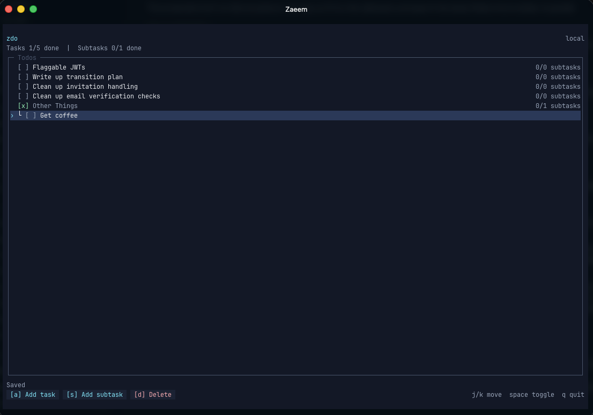

# zdo

zdo is a small local todo app for the terminal, built with Bun, TypeScript, React, and OpenTUI. It supports one level of subtasks. A task and its subtasks have independent completion states. Completing one never changes the others.



## Install zdo

zdo runs on [Bun](https://bun.sh/docs/installation), so install Bun first. Then install zdo globally:

```sh
bun install -g @zaeemadamjee/zdo
```

Or run it once without installing:

```sh
bunx @zaeemadamjee/zdo
```

npm and pnpm also work (`npm install -g @zaeemadamjee/zdo`), but Bun must still be installed because the `zdo` command runs under the Bun runtime.

You can now run zdo from any directory:

```sh
zdo
```

Bun puts global executables in `~/.bun/bin`. If your shell cannot find `zdo`, add that directory to your `PATH`:

```sh
export BUN_INSTALL="$HOME/.bun"
export PATH="$BUN_INSTALL/bin:$PATH"
```

Add those lines to `~/.zshrc` to keep the setting after you restart the shell.

### Install from a checkout

To run your own checkout as the global command instead, clone the repository and link it:

```sh
git clone https://github.com/zaeemadamjee/zdo.git
cd zdo
bun install
bun link
```

`bun link` points the global command at your checkout, so keep the cloned directory in place. To remove the global command, run `bun unlink` from the repository.

## Run from source

To work on zdo locally, install its dependencies and start it from the repository:

```sh
bun install
bun start
```

For automatic restarts while editing, run `bun run dev`.

## Controls

Keyboard controls work throughout the app. Mouse controls depend on terminal mouse support.

| Action | Keyboard | Mouse |
| --- | --- | --- |
| Move selection | `↑`, `↓`, `j`, or `k` | Click a row |
| Toggle selected item | `Space` | Click its checkbox |
| Add a task | `a` | Click **Add task** |
| Add a subtask | `s` | Click **Add subtask** |
| Save a new task or subtask | `Enter` | Not available |
| Cancel a new task or subtask | `Esc` | Not available |
| Delete selected item | `d` | Click **Delete** |
| Confirm deletion | `y` or `Enter` | Click **Delete** |
| Cancel deletion | `n` or `Esc` | Click **Cancel** |
| Scroll the list | Not available | Use the mouse wheel |
| Quit | `q` or `Ctrl-C` | Not available |

If a subtask is selected, adding a subtask creates a sibling under the same parent. Deleting a task that contains subtasks requires confirmation. Deleting that parent also deletes its subtasks.

## Data

zdo stores data as versioned JSON at:

```text
~/.local/share/zdo/todos.json
```

If `XDG_DATA_HOME` is set, zdo uses `$XDG_DATA_HOME/zdo/todos.json`. Set `ZDO_DATA_PATH` to use a specific file instead.

Each save writes a unique temporary file beside the data file and atomically renames it into place. A malformed file is left untouched and stops startup with an error so data is not silently discarded.

zdo is designed for one running process. If several instances edit the same file, the last completed save wins.

## Verify changes

Run the repeatable verification script:

```sh
bun run verify
```

It runs strict TypeScript checking followed by the behavior test suite.

## License

[MIT](LICENSE)
